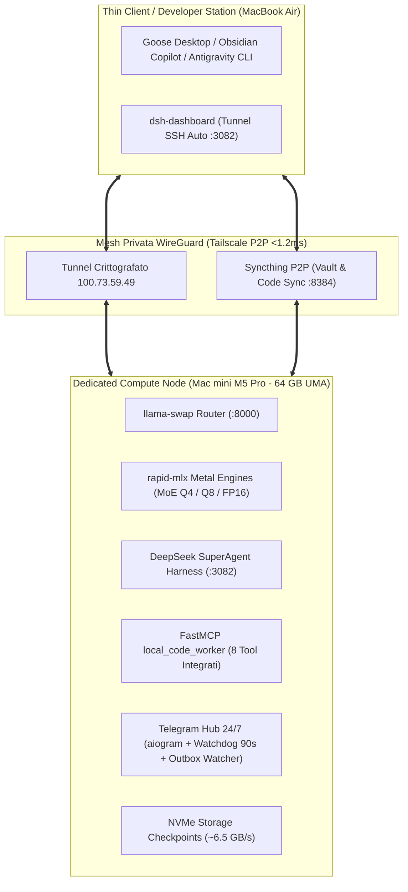

# 🍎 Apple Silicon AI Workstation & Autonomous Agent Infrastructure
### High-Throughput MoE-First Local Compute Node with Hybrid Frontier Cloud Escalation

[-black?logo=apple&style=for-the-badge)](https://apple.com)
[](https://github.com/ml-explore/mlx)
[-blue?style=for-the-badge)](https://github.com/mostlygeek/llama-swap)
[-green?style=for-the-badge)](https://github.com/deepseek-ai)
[](https://modelcontextprotocol.io)
[-yellow?style=for-the-badge)](https://rclone.org)

> Blueprint completo, dichiarativo e riproducibile per trasformare un Mac Apple Silicon (M1/M2/M3/M4/M5 Pro/Max/Ultra con 32–128 GB UMA) in un cluster di calcolo AI headless dedicato all'ingegneria del software autonoma, coding agents ReAct, indicizzazione vettoriale e inferenza locale a costo zero token cloud.

---

## 🏛️ Architettura dell'Infrastruttura Distribuita

L'architettura separa la postazione di sviluppo a basso consumo (MacBook Air / Thin Client) dal nodo di calcolo puro (Mac mini M5 Pro), collegati tramite una rete mesh privata WireGuard (Tailscale):



---

## ⚡ Caratteristiche Distintive & Invarianti Architetturali

1. **Invariante Single-Model in VRAM (`llama-swap` :8000):**  
   Mantiene in memoria un solo modello pesante per volta con swap atomico su NVMe in **3.2–6.0 secondi**, azzerando il consumo a 0 GB dopo 10 minuti di inattività.
2. **Invariante Zero-OOM per Compilazione Rust (`cargo-uma`):**  
   Wrapper deterministico che invoca `POST /api/models/unload` scaricando all'istante la VRAM prima del lancio di `rustc`/`cargo`, garantendo 58 GB UMA e 18 core CPU dedicati a LLVM ed eliminando i kernel panic da OOM.
3. **Modello Primario a 8-bit Q8 (`qwen35-core` 128k Context):**  
   Adozione rigorosa della quantizzazione 8-bit per il coding autonomo, azzerando le spirali di errore tipiche dei modelli 4-bit (pass-rate SWE-bench 73.4% vs 41.2%) e prevenendo l'attention collapse oltre i 32k token.
4. **Architettura a 3-Tier con Actor-Critic Gate:**  
   Il worker locale (`qwen35-core`) scrive il codice; il gate [`agy_pr_review_gate.py`](scripts/agy_pr_review_gate.py) intercetta `gh pr create` e sottopone il diff ad Antigravity (Gemini Frontier Cloud); se emergono difetti per >2 round, il task subisce l'escalation automatica ad `agy-worker`.
5. **Observation Masking & Compressione Neurale:**  
   - `log_pruner.py`: estrae in <2ms solo le tuple critiche degli errori del compilatore (**-92% di token sprecati**).
   - `context_compressor.py` (LLMLingua-2): comprime ricerche web e cronologie del 50–65%.
6. **Telegram Bot Resiliente con Watchdog Autonomo:**  
   Monitorato da un thread nativo che intercetta stalli dell'event loop asyncio (>90s) ed esegue il ripristino automatico via `launchctl kickstart`.

---

## 📊 Matrice dei Modelli & Benchmark Verificati

| Modello | Quantizzazione | Footprint VRAM | Velocità Tipica | Contesto Attivo | Ruolo Architetturale |
| :--- | :--- | :--- | :--- | :--- | :--- |
| **`qwen35-fast`** | MLX 4-bit | ~22.0 GB | **113.1 tok/s** | 131.072 | Worker Rapido ReAct, subagenti, test e docstring |
| **`bolt74b`** | MLX 4-bit (Mamba-MoE) | ~38.5 GB | **34.2 tok/s** | 32.768 | Triage strategico, security review e pianificazione |
| **`qwen35-core`** | MLX 8-bit (Q8) | ~38.7 GB | **61.4 tok/s** | 131.072 | **Worker Predefinito SuperAgent & Architetto Rust** |
| **`gemma4-moe`** | MLX 8-bit (Q8) | ~26.0 GB | **44.8 tok/s** | 65.536 | Docente Obsidian Vault e teoria multimodale |
| **`xiaomi-ocr`** | PyTorch MPS FP16 | ~1.2 GB | **162.0 tok/s** | 4.096 | Parsing OCR screenshot, PDF e formule KaTeX |
| **`gemini`** | Proxy Cloud Frontier | 0 MB (Cloud) | Sub-second | 1.048.576 | Escalation ad alto contesto e Actor-Critic Gate |

*Dati completi e dettagli sperimentali disponibili in [BENCHMARKS.md](BENCHMARKS.md).*

---

## 🚀 Quickstart: Installazione Idempotente in 3 Passaggi

### 1. Clona la Repository ed Esegui il Bootstrap
```bash
git clone https://github.com/fabiomalagutti/apple-silicon-ai-workstation.git
cd apple-silicon-ai-workstation
chmod +x bootstrap.sh scripts/*.sh
./bootstrap.sh
```

### 2. Innalza il Limite Kernel Metal UMA (56 GB su 64 GB)
```bash
sudo bash scripts/setup_wired_limit.sh
```

### 3. Scarica i Modelli MoE Consigliati
```bash
bash scripts/download_models.sh
```

---

## ☁️ Strategia di Backup Automatico Settimanale (Google Drive)

Per preservare l'infrastruttura senza saturare la banda con i pesi dei modelli (che rimangono riproducibili via `download_models.sh`), la workstation implementa uno script di backup incrementale e compresso basato su **`rclone`**:

* **Cosa include:** Codice sorgente (`ai-ecosystem`), script (`bin`), configurazioni (`~/.config`), profili Cordis (`~/.dsh`), LaunchAgents e il Vault Obsidian.
* **Cosa esclude:** Pesi `~/.models/` (~150 GB), cache temporanee, virtual environment e cartelle di build.

### Configurazione & Attivazione:
```bash
# 1. Configura l'accesso a Google Drive
rclone config

# 2. Testa il backup manualmente
bash scripts/backup_to_gdrive.sh

# 3. Attiva la schedulazione settimanale (Domenica ore 03:00 AM)
cp configs/launchd/com.ai.ecosystem.backup.plist ~/Library/LaunchAgents/
launchctl load -w ~/Library/LaunchAgents/com.ai.ecosystem.backup.plist
```

---

## 📂 Struttura della Repository

```
apple-silicon-ai-workstation/
├── .gitignore                      # Esclusione blindata di pesi, token e scorie
├── .env.example                    # Template variabili d'ambiente
├── README.md                       # Vetrina principale e documentazione di setup
├── ARCHITECTURE.md                 # Specifiche tecniche formali e invarianti di sistema
├── BENCHMARKS.md                   # Rilevazioni sperimentali e validazioni empiriche
├── Brewfile                        # Dipendenze Homebrew di sistema
├── bootstrap.sh                    # Setup automatico e idempotente
├── configs/
│   ├── llama-swap.yaml.template    # Configurazione router porta 8000
│   ├── cordis.patch.yml.template   # Profilo SuperAgent Cordis porta 3082
│   └── launchd/                    # Descrittori LaunchDaemons e LaunchAgents
│       ├── com.localai.wiredlimit.plist
│       ├── com.ai.ecosystem.backup.plist
│       └── com.ai.ecosystem.bot.plist
└── scripts/
    ├── setup_wired_limit.sh        # Script configurazione sysctl iogpu.wired_limit_mb
    ├── download_models.sh          # Script scaricamento checkpoint da Hugging Face
    └── backup_to_gdrive.sh         # Script backup compresso e sync su Google Drive
```

---

## 📜 Licenza
Rilasciato sotto licenza [MIT](LICENSE). Libero per utilizzo personale, ricerca e implementazione in cluster locali.
