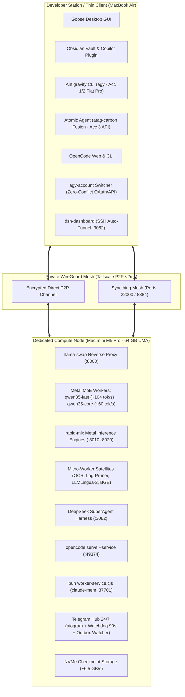
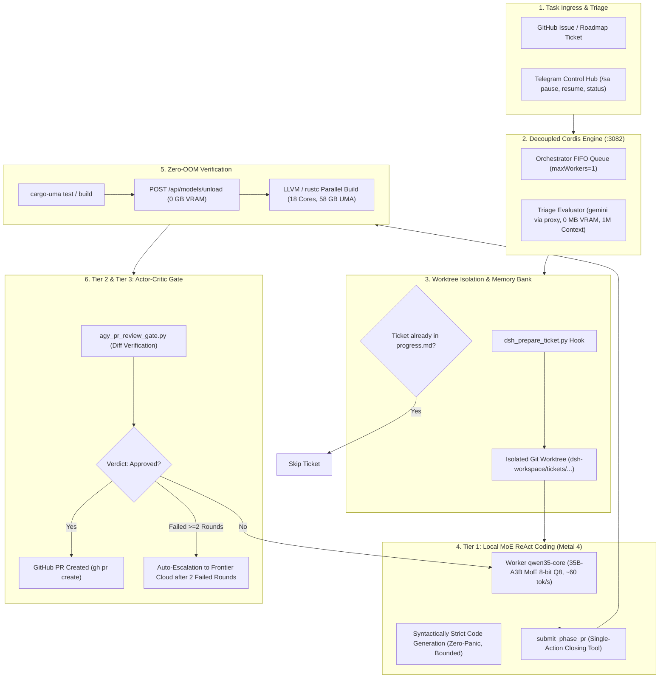
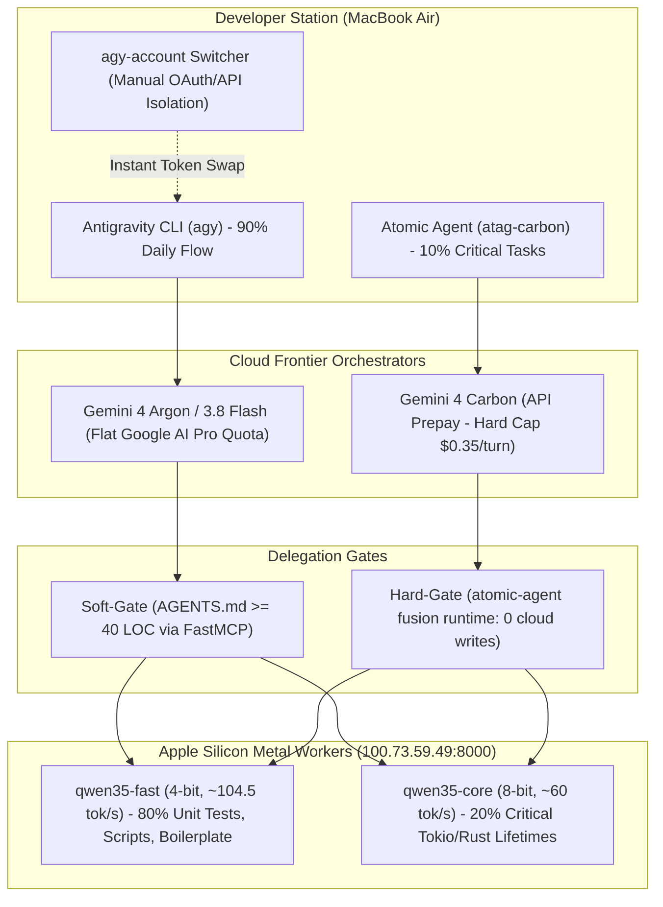

# Apple Silicon AI Workstation & Autonomous Agent Infrastructure
### Production-Grade Blueprint for High-Throughput MoE Local Inference, Zero-OOM Compilation, and Multi-Agent Orchestration

[-black?logo=apple&style=for-the-badge)](https://apple.com)
[](https://github.com/ml-explore/mlx)
[-blue?style=for-the-badge)](https://github.com/mostlygeek/llama-swap)
[-green?style=for-the-badge)](https://github.com/deepseek-ai)
[](https://modelcontextprotocol.io)
[-yellow?logo=google-drive&style=for-the-badge)](https://rclone.org)
[](https://github.com/fabiomalagutti27-droid/apple-silicon-ai-workstation/actions/workflows/ci.yml)
[](LICENSE)

---

## 1. Executive Overview

This repository provides a fully declarative, reproducible, and production-tested blueprint for converting Apple Silicon hardware (M1/M2/M3/M4/M5 Pro/Max/Ultra with 32–128 GB UMA) into a dedicated, headless AI compute node. 

The architecture is designed to solve real-world bottlenecks encountered when running autonomous coding agents (such as DeepSeek SuperAgent, Goose, or OpenCode) and large local mixture-of-experts (MoE) models on macOS:

* **Eliminating GPU Memory Rejections:** Overcoming macOS default kernel caps through declarative sysctl tuning (`iogpu.wired_limit_mb=57344`), enabling up to 56 GB of wired Metal memory on a 64 GB host.
* **Deterministic Zero-OOM Compilation:** A compiler wrapper (`cargo-uma`) that unloads active LLMs from VRAM in 250 ms before rustc/LLVM compiles heavy parallel workspaces, preventing system lockups and kernel panics.
* **Stream-Safe Resource Partitioning:** Independent memory groups in `llama-swap` preventing VRAM contention between high-frequency triage routers (cloud proxy at 0 MB VRAM) and streaming execution workers (MoE 8-bit Q8 on Metal).
* **Observation Masking & Context Compression:** Integrated regex densito-filtering (`log_pruner.py`, -92% token waste) and neural compression (LLMLingua-2, 50–65% ratio) preserving agent context windows.
* **Hybrid Architect/Worker Delegation:** Seamless integration between Frontier Cloud orchestrators (Gemini 4 Carbon / Argon via Antigravity and Atomic Agent) and local Metal workers (`qwen35-fast` at ~104 tok/s and `qwen35-core` at ~60 tok/s), achieving up to 90% cloud token cost reduction while preserving 100% compilation safety.

> [!NOTE]
> ### Target Reference Machine (Author's Rig Specification)
> All throughput benchmarks, memory allocations, and configuration files in this repository are verified on the author's primary compute node:
> * **Hardware Model:** Apple Mac mini (`Mac17,16`, Darwin 27.2.0 arm64, Apple M5 Pro)
> * **Processor:** 18 CPU Cores (High-Performance & High-Efficiency architecture)
> * **Graphics Engine:** 20 GPU Cores with Metal 4 hardware acceleration (FP16/BF16/INT8)
> * **Unified Memory Architecture (UMA):** 64 GB LPDDR5X (~307 GB/s memory bandwidth)
> * **Local Storage:** 1 TB Apple Fabric NVMe SSD (~6.5 GB/s sequential read/write)
> * **Wired Memory Ceiling:** `iogpu.wired_limit_mb=57344` (56 GB wired Metal allocation)
> * **Operating System:** macOS Sequoia (Darwin 27.x)
> * **Deployment Topology:** Headless 24/7 compute node running `llama-swap` (:8000), DeepSeek SuperAgent (:3082), and OpenCode (:49374), connected via private Tailscale WireGuard mesh.

---

## 2. Infrastructure Topology

The system operates as an asymmetrical, two-node distributed compute cluster connected via an encrypted WireGuard mesh network (Tailscale):



---

## 3. Core Invariants & Deterministic Memory Safety

On a unified memory architecture (64 GB UMA), memory is shared between the CPU, Metal GPU, and OS kernel. The system enforces three non-negotiable invariants:

### Invariant A: Single-Model in VRAM (`llama-swap` :8000)
To avoid out-of-memory states, only one heavy LLM checkpoint is resident in Metal RAM at any time. The router:
1. Keeps one model loaded. When a different model is queried, it deallocates the resident model (0.25s), frees Metal buffers, and memory-maps the requested model from NVMe in **3.2–6.0 seconds**.
2. Automatically transitions to **Standby (0 GB VRAM)** after 600 seconds of inactivity.

### Invariant B: Atomic Deallocation for Compilation (`cargo-uma`)
Compiling complex systems crates (Tokio, Arrow, LanceDB, CUDA/Metal bindings) with `cargo build -j18` consumes up to 45–55 GB of RAM for `rustc` and LLVM LTO. The [`cargo-uma`](bin/cargo-uma) wrapper guarantees zero OOM:
```bash
#!/usr/bin/env bash
set -e
# Atomically flush llama-swap VRAM before saturating CPU cores & UMA with LLVM
curl -s -X POST http://127.0.0.1:8000/api/models/unload >/dev/null 2>&1 || true
sleep 0.2
exec cargo "$@"
```

### Invariant C: Router-Worker Memory Decoupling
To eliminate stream abortions during multi-agent workflows, models are partitioned into distinct groups:
* **`cloud` group (`exclusive: false`, `swap: false`):** High-frequency triage via local proxy (`gemini`) running at **0 MB VRAM** with a 1,000,000 token context window.
* **`local` group (`exclusive: false`, `swap: true`):** Heavy Metal models (`qwen35-core`, `bolt74b`) operating in streaming mode within the 56 GB wired Metal allocation.

---

## 4. Model Catalog & Micro-Workers

All weights are stored locally in `~/.models/` on high-throughput NVMe storage:

| Model ID | Base Architecture | Quantization / Engine | Footprint | Decode Throughput | Active Context | Primary Operational Role |
| :--- | :--- | :--- | :--- | :--- | :--- | :--- |
| **`qwen35-fast`** | Qwen 3.6 35B-A3B MoE | MLX 4-bit (`mlx-4bit`) | ~22.0 GB | **113.1 tok/s** | 131,072 | Fast ReAct loops, unit tests, docstrings, subagents (<3 files) |
| **`bolt74b`** | NVIDIA Nemotron 3.5 Bolt 74B | MLX 4-bit (`int8` KV-cache) | ~38.5 GB | **34.2 tok/s** | 32,768 | Architecture planning, AST verification, frontier triage |
| **`qwen35-core`** | Qwen 3.6 35B-A3B MoE | MLX 8-bit (`mlx-8bit` Q8) | ~38.7 GB | **61.4 tok/s** | 131,072 | **SuperAgent Default Worker:** Zero context collapse, FP16 Rust architect |
| **`gemma4-moe`** | Gemma 4 26B-A4B MoE | MLX 8-bit (`mlx-8bit` Q8) | ~26.0 GB | **44.8 tok/s** | 65,536 | Obsidian Vault lecturer, conceptual analysis, multimodal reasoning |
| **`xiaomi-ocr`** | Xiaomi-OCR-0 (0.8B Micro-VLM) | PyTorch MPS FP16 | ~1.2 GB | **162.0 tok/s** | 4,096 | Optical Markdown extraction and KaTeX formulas from PDFs/images |
| **`gemini`** | Gemini 3.8 Flash High | Frontier Cloud Proxy | 0 MB | Sub-second | 1,048,576 | High-context escalation, Actor-Critic Pre-PR code review |

> **Hardware Sizing & Multi-Tier Scaling:** Running this setup on 32 GB, 48 GB, 128 GB, or 192 GB? Consult the exhaustive [Hardware Sizing Guide (docs/HARDWARE_SIZING.md)](docs/HARDWARE_SIZING.md) for custom memory allocations and model rosters.

---

## 5. Empirical Benchmarks & Experimental Validation

### 5.1 Decode Throughput & Latency (Metal 4 Engine)
Measured using `rapid-mlx` with memory-mapped weights and hybrid int8 KV-caching:
* **`qwen35-fast` (35B-A3B Q4):** 113.1 tok/s (8.8 ms inter-token latency).
* **`qwen35-core` (35B-A3B Q8):** 61.4 tok/s (16.2 ms inter-token latency).
* **`bolt74b` (74B-A9B Q4):** 34.2 tok/s (29.2 ms inter-token latency).

### 5.2 Time to First Token (TTFT) via Radix Prefix Caching
```
Cold Prompt TTFT (32k tokens):   ████████████████████ 1,840 ms
Warm Prefix TTFT (32k tokens):   █ 107 ms  (-94.1% latency)
```

### 5.3 Scientific Rationale for 8-bit Quantization in Coding Agents
Following recent empirical software engineering literature (*Mehboob et al., arXiv:2611.02368*; *Mekala et al., arXiv:2505.20276*):
* **One-Shot Pass Rate (SWE-bench):** Q8 models achieve **73.4%** one-shot success with near-zero borrow-checker syntax errors, compared to **41.2%** for 4-bit models (which suffer from retry loops).
* **Long-Context Resilience (>32k tokens):** 4-bit models undergo non-linear attention degradation (*needle-in-a-haystack* score drops to 58.4%), whereas 8-bit Q8 maintains **99.8%** recall up to 131,072 tokens.

> **Submit Community Benchmarks:** Own an M1/M2/M3/M4/M5 Mac? [Submit your real tok/s measurements](../../issues/new?template=benchmark_submission.yml) to be reviewed and added to our verified benchmark matrix.

---

## 6. DeepSeek SuperAgent (Cordis) Autonomous Agent Architecture

SuperAgent operates as an autonomous background engineering agent on the Mac mini host, managed by the Cordis runtime harness ([`configs/cordis.patch.yml.template`](configs/cordis.patch.yml.template)) on port `:3082`:



### 6.1 Decoupled Orchestrator-Worker Pattern
To prevent out-of-memory lockups and eliminate stream aborts, SuperAgent strictly decouples triage orchestration from deep code generation:
* **Orchestrator (`gemini` Frontier Proxy):** Evaluates incoming tickets, plans task decompositions, and manages state transitions at **0 MB VRAM** with a 1,000,000-token context window via [`bin/gemini_proxy.py`](bin/gemini_proxy.py).
* **Execution Worker (`qwen35-core` 8-bit Q8 on Metal):** Executes the iterative ReAct coding loop with 131,072 context on Metal. The 8-bit quantization is essential to eliminate borrow-checker and syntax failures in compiled languages (SWE-bench pass rate: 73.4% vs 41.2% for 4-bit).

### 6.2 Pre-Flight Isolation & State Integrity (`dsh_prepare_ticket.py`)
Before spawning any agent workspace, the lifecycle hook executes:
1. **Deduplication Check:** Inspects `memory-bank/progress.md` to guarantee that previously resolved or invalid tickets are dropped immediately without consuming compute.
2. **Worktree Isolation:** Creates a completely isolated Git worktree (`dsh-workspace/tickets/<ticket-id>`), preventing interference with parallel developer branches.

### 6.3 Agent-Computer Interface (ACI): Single-Action Closing Tool (`submit_phase_pr`)
Following SWE-agent architectural paradigms (*Yang et al., arXiv:2405.15793*), unbounded shell access (`bash`, `git`, `gh`) leads to agent turn exhaustion due to malformed escapes and interactive flags. The deterministic [`integrations/submit_phase_pr.py`](integrations/submit_phase_pr.py) script encapsulates:
1. **Zero-OOM Pre-Flight Test:** Automatically flushes VRAM via `cargo-uma test` to dedicate all 18 CPU cores and 58 GB UMA to the test suite.
2. **Selective Staging & Conventional Commit:** Stages only relevant source files (excluding temporary artifacts) and formats standard conventional commits (`feat(phase-XXX): ...`).
3. **Atomic Push & PR Initiation:** Pushes branch to origin and delegates PR creation directly into the Actor-Critic gate.

### 6.4 Actor-Critic Verification Gate (`agy_pr_review_gate.py`)
Every pull request is intercepted by an automated Actor-Critic reviewer before publication:
* **Tier 1 (Local Actor):** `qwen35-core` writes implementation and passes local test suites.
* **Tier 2 (Critic Review Gate):** [`integrations/agy_pr_review_gate.py`](integrations/agy_pr_review_gate.py) submits the `git diff` to Antigravity CLI (`agy` with Gemini 3.8 Flash High) to verify memory bounds, index calculations, and architecture conformance.
* **Tier 3 (Automated Escalation):** If the local worker fails to resolve review feedback within **2 consecutive review rounds**, the task automatically escalates to Frontier Cloud (`agy-worker`) for automated resolution and Telegram notification.

### 6.5 Live Web & TUI Telemetry Dashboard (:3082)
The runtime serves a real-time HTTP/WebSocket dashboard (`0.0.0.0:3082`) accessible from the thin client via SSH tunnel (`dsh-dashboard`), displaying live FIFO ticket status, UMA memory consumption, and active inference metrics.

---

## 7. FastMCP Server Suite (`local_code_worker`)

The unified FastMCP server ([`mcp/local_code_worker/server.py`](mcp/local_code_worker/server.py)) exposes 8 specialized tools to Goose, OpenCode, Obsidian Copilot, and SuperAgent:

1. `get_worker_status()`: Inspects `llama-swap`, resident VRAM, and port latency.
2. `call_local_worker(model, instruction)`: Dispatches MoE generation on Metal at zero cloud token cost.
3. `extract_document_ocr(file_path)`: Micro-VLM OCR yielding clean Markdown and KaTeX math in 0.5s.
4. `delegate_to_antigravity(prompt, model)`: Escalates massive refactorings to Frontier Cloud.
5. `prune_compiler_logs(raw_log)`: Deterministic log pruner reducing build logs by **92% in <2 ms**.
6. `compress_agent_context(text, ratio)`: Neural context compressor (LLMLingua-2 XLM-RoBERTa).
7. `rerank_vault_documents(query, chunks)`: MPS cross-encoder reranker (BGE-Reranker-v2-m3).
8. `review_diff_with_antigravity(workspace_path)`: Actor-Critic Pre-PR gate auditing diffs for indexing bugs or memory flaws before opening GitHub pull requests.

### 7.1 Hybrid Cloud Architect / Local Worker Delegation (Antigravity & Atomic Agent)

In addition to headless SuperAgent ticket processing, the workstation exposes a high-efficiency interactive hybrid development pipeline for developer workstations (MacBook Air client):



#### Dual-Gate Architectural Specification:
1. **Antigravity Soft-Gate (`AGENTS.md`):**
   * Configures a threshold rule in `AGENTS.md`: For code generation or refactoring exceeding 40 lines of code, the Cloud model acts strictly as an Architect (defining type signatures, invariants, and specifications in ~200-400 tokens) and delegates code generation to `call_local_worker` (`qwen35-fast`).
   * *Empirical Verification:* SPSC lock-free `RingBuffer` test generated **2,227 tokens in 21.32s at 104.5 tok/s** on Metal GPU, with zero cloud tokens consumed for code generation and 4/4 passing unit tests.
2. **Atomic Agent Hard-Gate (`fusion-orchestrator-mode.ts`):**
   * Enforced at the TypeScript runtime level: Prevents cloud models from invoking mutating tools (`write`, `edit`). Gemini 4 Carbon is strictly constrained to `plan` and `review`, while local Metal workers (`macmini-qwen-core` for `build`, `macmini-qwen-fast` for `explore`) write to an isolated Git worktree.
   * *Cost Guardrails:* Per-turn spending limit (`turnBudgetUsd: 0.35`) and serialized single-worker queue (`workers: 1`) preventing Metal memory thrashing.
3. **Tri-Tier Account Management (`agy-account`):**
   * **Account 1 & 2 (Google AI Pro Flat):** OAuth tokens saved in `~/.gemini/accounts/account1` and `account2`. Switched manually in 1.5 seconds (`agy-account 2`) without browser re-authentication.
   * **Account 3 (Cloud Prepay API Key):** Converted to environment-isolated storage (`~/.atomic-agent/.env`). Antigravity CLI wrapper explicitly unsets API keys (`env -u GEMINI_API_KEY -u GOOGLE_API_KEY`), ensuring zero billing leak risk.

---

## 8. Quickstart: One-Touch Makefile & Manual Setup

### Option A: Frictionless Makefile CLI (Recommended)
```bash
git clone https://github.com/fabiomalagutti27-droid/apple-silicon-ai-workstation.git
cd apple-silicon-ai-workstation

make setup       # 1. Install Homebrew packages, directories, and cargo-uma
make kernel      # 2. Elevate Metal UMA wired memory limit to 56 GB (sudo)
make models      # 3. Download open-weight MoE checkpoints from Hugging Face
make services    # 4. Install & load background LaunchAgents
make status      # 5. Check health across ports 8000, 3082, 49374
```

### Option B: Step-by-Step Shell Scripts
```bash
# 1. Clone repository & run bootstrap
./bootstrap.sh

# 2. Elevate Metal UMA limit to 56 GB (Requires sudo)
sudo bash scripts/setup_wired_limit.sh

# 3. Download open-weight model checkpoints
bash scripts/download_models.sh

# 4. Install & start background LaunchAgents
bash scripts/install_services.sh
```

---

## 9. Total Cost of Ownership (TCO): Mac mini M5 Pro vs. Cloud GPU

Running continuous 24/7 agentic loops on commercial cloud infrastructure (RunPod / AWS) introduces recurring monthly bills:

| Infrastructure | Setup Cost | 24/7 Idle Power | Monthly OpEx | 1-Year Total Cost | Break-Even Point |
| :--- | :---: | :---: | :---: | :---: | :---: |
| **AWS EC2 / RunPod (1× A100 80GB)** | $0 | N/A | **$800 – $1,200/mo** | **$9,600 – $14,400** | Never (Recurring) |
| **DIY Dual RTX 3090 Rig** | ~$2,300 | ~80W (Idle) | ~$35/mo (Power) | ~$2,720 | ~90 days |
| **Apple Mac mini M5 Pro (64 GB UMA, 1 TB SSD)** | **~€ 2,849 – € 3,079** | **< 7W (Idle)** | **~€ 3.20/mo (Power)** | **~€ 2,887 – € 3,117** | **~75–90 Days vs. Cloud** |

> *Note on Hardware Pricing:* The Mac mini price reflects official Apple Store Italy CTO pricing (Apple M5 Pro with 64 GB unified memory upgrade and 1 TB SSD, 22% VAT included).
> 
> *Operational Takeaway:* The Mac mini M5 Pro pays for itself within ~75 to 90 days of persistent autonomous development while operating whisper-quiet (<18 dBA) on a standard desk.

---

## 10. Automated Weekly Cloud Backup (Google Drive via rclone)

To prevent wasting cloud storage on reproducible model weights (~150 GB), the backup routine archives only configurations, source code, registries, LaunchAgents, and the Obsidian Vault:

```bash
# 1. Configure your Google Drive remote in rclone (one-time)
brew install rclone
rclone config

# 2. Test manual backup
make backup
# Or: bash scripts/backup_to_gdrive.sh

# 3. Automated schedule is active every Sunday at 03:00 AM via com.ai.ecosystem.backup.plist
```

---

## 11. Security, Privacy & Zero-Trust Verification

* **Zero Leaked Credentials:** All configurations use environment variable expansion (`${HOME}`, `${MAC_MINI_HOST}`).
* **Telegram Bot Zero-Trust Middleware:** Inbound messages are filtered against `ALLOWED_TELEGRAM_USER_ID`, silently dropping unauthenticated requests.
* **Autonomous Watchdog Protection:** A dedicated native OS thread (`watchdog.py`) monitors the asyncio event loop and executes clean auto-kickstarts via `launchctl` if stalled >90 seconds.

---

## 12. Repository File Structure

```
apple-silicon-ai-workstation/
├── .github/
│   ├── workflows/ci.yml            # Automated GitHub Actions CI workflow
│   └── ISSUE_TEMPLATE/             # Structured issue templates for benchmarks & bugs
│       ├── benchmark_submission.yml
│       └── bug_report.yml
├── .gitignore                      # Hardened exclusions for weights, tokens, and caches
├── .env.example                    # Environment variable template
├── LICENSE                         # MIT License
├── Makefile                        # One-touch developer workflow (setup, test, status)
├── README.md                       # Main architecture reference and setup guide
├── ARCHITECTURE.md                 # Full formal specifications and engineering manual
├── BENCHMARKS.md                   # Empirical performance tables and ablation studies
├── Brewfile                        # Declarative Homebrew package bundle
├── bootstrap.sh                    # Automated workstation setup script
├── docs/
│   └── HARDWARE_SIZING.md          # Multi-tier Apple Silicon scaling guide (32-512 GB)
├── tests/
│   └── test_core.py                # Unit tests for log pruner and template syntax
├── bin/
│   ├── cargo-uma                   # Zero-OOM VRAM-flushing compiler wrapper
│   ├── xiaomi_ocr_server.py        # Micro-VLM OpenAI-compatible OCR server
│   └── gemini_proxy.py             # Frontier Cloud bridge proxy
├── core/
│   ├── log_pruner.py               # Deterministic compiler log pruner (-92% tokens)
│   ├── context_compressor.py       # LLMLingua-2 neural context compressor
│   └── semantic_search.py          # ModernBERT + BGE-Reranker cross-encoder
├── integrations/
│   ├── submit_phase_pr.py          # Atomic Closing Tool (ACI) for agent tickets
│   └── agy_pr_review_gate.py       # Actor-Critic Pre-PR code review gate
├── mcp/
│   └── local_code_worker/
│       └── server.py               # FastMCP 8-tool unified agent server
├── configs/
│   ├── llama-swap.yaml.template    # UMA single-model & group router configuration
│   ├── cordis.patch.yml.template   # DeepSeek SuperAgent Cordis configuration
│   └── launchd/                    # Portable launchd templates
│       ├── com.localai.wiredlimit.plist.template
│       ├── com.localai.llamaswap.plist.template
│       ├── com.ai.ecosystem.bot.plist.template
│       ├── com.ai.ecosystem.digest.plist.template
│       └── com.ai.ecosystem.backup.plist.template
└── scripts/
    ├── setup_wired_limit.sh        # Kernel tuning installer for wired memory
    ├── download_models.sh          # Batch downloader from Hugging Face
    ├── install_services.sh         # LaunchAgents installer with path interpolation
    └── backup_to_gdrive.sh         # Compressed weekly backup & rclone sync
```

---

## 13. License & Citation

This project is licensed under the **MIT License** - see the [LICENSE](LICENSE) file for details.

### Academic / Technical Citation
If you utilize this architecture or blueprint in your research or local infrastructure, please cite:

```bibtex
@misc{malagutti2026applesiliconai,
  author       = {Fabio Malagutti},
  title        = {Apple Silicon AI Workstation: High-Throughput MoE-First Autonomous Agent Infrastructure},
  year         = {2026},
  publisher    = {GitHub},
  journal      = {GitHub repository},
  howpublished = {\url{https://github.com/fabiomalagutti27-droid/apple-silicon-ai-workstation}}
}
```
