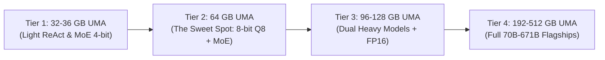

# Apple Silicon AI Hardware Sizing & Scaling Guide
## Unified Memory Architecture (UMA) Tiers, Model Allocations, and Power Profiles

This guide provides an architectural blueprint for scaling the **Apple Silicon AI Workstation** setup across different memory configurations (32 GB to 512 GB UMA).

---

## 1. The Kernel Memory Allocation Rule

On Apple Silicon, macOS dynamically balances unified RAM across the CPU, Metal GPU, and Apple Neural Engine (ANE). By default, macOS restricts user-space Metal allocations to ~70–75% of total system RAM to reserve headroom for the WindowServer and system daemons.

For headless compute nodes, this conservative cap must be raised via `/usr/sbin/sysctl iogpu.wired_limit_mb` using the **Headroom Buffer Formula**:

$$\text{Wired Limit (MB)} = (\text{Total RAM in GB} - \text{Buffer GB}) \times 1024$$

| System RAM | Recommended Buffer | Wired Limit (`sysctl`) | Usable Metal RAM | Target Machine |
| :---: | :---: | :---: | :---: | :--- |
| **32 GB – 36 GB** | 6 GB | **26,624 MB** (26 GB) | ~26 GB | MacBook Pro M3/M4 Pro |
| **48 GB** | 6 GB | **43,008 MB** (42 GB) | ~42 GB | MacBook Pro M4 Pro |
| **64 GB** *(Sweet Spot)* | 8 GB | **57,344 MB** (56 GB) | ~56 GB | **Mac mini M5 Pro / Mac Studio** |
| **96 GB – 128 GB** | 12 GB | **118,784 MB** (116 GB) | ~116 GB | Mac Studio M2 Max / MacBook Pro Max |
| **192 GB – 512 GB** | 16 GB | **180,224 MB – 507,904 MB** | ~176–496 GB | Mac Studio M2 Ultra / Mac Pro |

---

## 2. Hardware Tier Breakdown & Model Matrix

### Tier 1: 32 GB – 36 GB (Entry-Level Agentic Node)
* **Target Hardware:** Mac mini M2 Pro (32GB), MacBook Pro M3/M4 Pro (36GB).
* **Wired Limit:** `iogpu.wired_limit_mb=26624` (26 GB).
* **Model Configuration:**
  * **Primary Worker:** `qwen3.6-35b-a3b-mlx-4bit` (~22 GB footprint) at **~100 tok/s** with 32k context.
  * **OCR Micro-VLM:** `xiaomi-ocr-0` (1.2 GB).
  * **Router Policy:** Single-model exclusive swap (`ttl: 300`). Router triage delegated to Cloud (`gemini` proxy at 0 MB VRAM).

---

### Tier 2: 64 GB – 72 GB (The Architectural Sovereign Sweet Spot)
* **Target Hardware:** **Apple Mac mini M5 Pro (64GB)**, Mac Studio M1/M2 Max (64GB).
* **Wired Limit:** `iogpu.wired_limit_mb=57344` (56 GB).
* **Why it's the Sweet Spot:**
  * Allows loading **8-bit Q8 MoE models (`qwen35-core`)** with a **131,072 token context window** (footprint ~38.7 GB), eliminating the attention collapse and one-shot pass failures of 4-bit models.
  * Leaves **17.3 GB of free wired buffer** for KV-cache expansion, OCR satellites, and system threads.
  * Executes atomic NVMe swap of 40 GB checkpoints in **3.4 to 6.1 seconds** at ~6.5 GB/s.
* **Model Configuration:**
  * Primary Coding Worker: `qwen35-core` (Q8 8-bit, 131k ctx, 61.4 tok/s).
  * Fast ReAct & Subagents: `qwen35-fast` (4-bit, 131k ctx, 113.1 tok/s).
  * Reasoning Leader: `bolt74b` (Mamba-MoE 4-bit, int8 KV, 34.2 tok/s).
  * Vault Lecturer: `gemma4-moe` (8-bit Q8, 65k ctx, 44.8 tok/s).

---

### Tier 3: 96 GB – 128 GB (Enterprise Multi-Model Workstation)
* **Target Hardware:** Mac Studio M2 Max (96GB), MacBook Pro M3/M4 Max (128GB).
* **Wired Limit:** `iogpu.wired_limit_mb=118784` (116 GB).
* **Model Configuration:**
  * Supports keeping **two heavy models resident simultaneously** in non-exclusive groups (e.g. `qwen35-core` at 38 GB + `bolt74b` at 38 GB = 76 GB total resident).
  * Capable of serving `Llama-3.3-70B-Instruct` in 8-bit Q8 (~72 GB) with 64k context at **~24 tok/s**.
  * Eliminates NVMe swap delays for dual-agent architectures (Actor and Critic both live in VRAM).

---

### Tier 4: 192 GB – 512 GB (Frontier On-Premise Cluster)
* **Target Hardware:** Mac Studio M2 Ultra (192GB), Mac Pro (192GB–512GB).
* **Wired Limit:** `iogpu.wired_limit_mb=180224` (176 GB).
* **Model Configuration:**
  * Can run massive quantized flagships like **DeepSeek-V3 / DeepSeek-R1** (671B MoE quantized to 3-bit / 4-bit at ~240–320 GB footprint).
  * Dense 70B models in full FP16 precision at **~32 tok/s**.

---

## 3. Power Consumption, Thermals & Acoustic Profile

One of the greatest advantages of Apple Silicon over multi-GPU x86 server builds (such as 4× RTX 3090/4090 consuming 1,200W–1,800W) is operational efficiency:

| Operational State | Mac mini M5 Pro (64 GB) | 2× RTX 3090 Rig | 4× RTX 4090 Server |
| :--- | :---: | :---: | :---: |
| **Idle / Standby (0 GB VRAM)** | **5.8 W – 7.2 W** | 65 W – 90 W | 140 W – 210 W |
| **Active MoE Generation (61 tok/s)** | **42 W – 68 W** | 450 W – 600 W | 1,100 W – 1,600 W |
| **Full Parallel Compilation (18 cores)** | **74 W** | 350 W | 700 W |
| **Acoustic Noise (Under Full Load)** | **< 18 dBA (Whisper-Quiet)** | 48 dBA – 55 dBA | > 62 dBA (Server Rack) |
| **Annual Electricity Cost (24/7)** | **~€ 38 / year** | ~€ 380 / year | ~€ 1,100 / year |

---

## 4. Total Cost of Ownership (TCO) vs. Cloud Instances

Running persistent autonomous agents (like DeepSeek SuperAgent polling GitHub and executing iterative ReAct loops 24/7) on commercial cloud infrastructure becomes cost-prohibitive:

* **AWS / RunPod Cloud GPU (A100 80GB or 2× A10G 24GB):**
  * Average cost: ~$1.10 – $1.85 / hour.
  * Monthly 24/7 bill: **$790 – $1,330 / month**.
  * Annual cost: **$9,480 – $15,960 / year**.
* **Apple Mac mini M5 Pro (64 GB UMA) Owned Node:**
  * Upfront Hardware Investment: **~€ 2,100**.
  * Operational Cost: Zero token fees for local workers + negligible electricity (~€38/year).
  * **Break-Even Point (ROI):** Achieved within **50 to 75 days** of continuous autonomous development.
